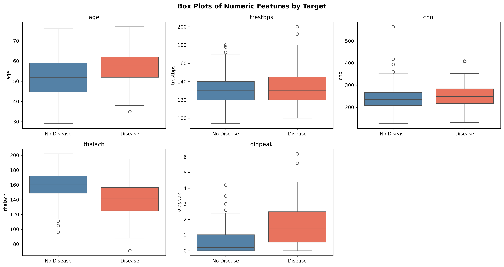
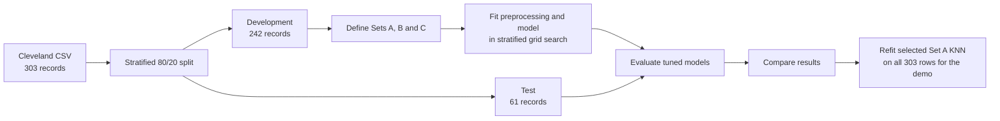
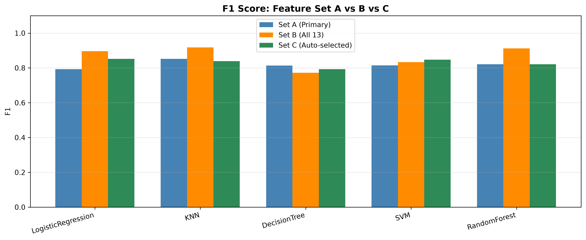

# Heart Disease Prediction System

This BAI503 Machine Learning case study compares five classifiers for predicting the recorded presence of heart disease in the Cleveland dataset. It asks how much model performance changes when the six assignment predictors are expanded to all 13 predictors or reduced using training-data feature selection.

The six-feature K-Nearest Neighbours (KNN) model led its test comparison with **F1 0.8519**, **ROC-AUC 0.9080**, and **53 correct predictions out of 61**. With all 13 inputs, KNN reached **F1 0.9180** and detected all 28 positive cases on the same split. Logistic Regression led the six-feature comparison by mean F1 in repeated cross-validation, so the choice of evaluation protocol affects the ranking.

The models classify a historical dataset for an educational demonstration. Their scores are unsuitable for clinical decisions.

## Contents

- [Quick start](#quick-start)
- [Dataset and exploratory analysis](#dataset-and-exploratory-analysis)
- [Experimental design](#experimental-design)
- [Benchmark results](#benchmark-results)
- [Sensitivity experiments](#sensitivity-experiments)
- [Educational prediction demo](#educational-prediction-demo)
- [Limitations](#limitations)
- [Repository guide](#repository-guide)

## Quick start

Run these commands from the repository root. The committed results can be reviewed directly in the [analysis notebook](notebooks/heart_disease_analysis.ipynb) or the [results tables](outputs/tables/).

```bash
python -m venv .venv
source .venv/bin/activate
python -m pip install -r requirements.txt
```

Run the training and evaluation pipeline, followed by the sensitivity experiments.

```bash
python run_pipeline.py
python improve_pipeline.py
```

- `run_pipeline.py` loads the data, creates the binary target, generates the exploratory figures, tunes 15 model and feature-set combinations, and exports metrics, figures, and the fitted demonstration pipeline.
- The loader first tries `ucimlrepo` for dataset ID 45. For offline execution, place the original headerless `processed.cleveland.data` file in `data/raw/`. The committed `heart_disease_raw.csv` is a separate inspection snapshot with a header.
- `improve_pipeline.py` uses the processed CSV and saved hyperparameter table. It reruns the threshold, class-weight, and voting comparisons and appends the experiment section to the results summary.
- Start the notebook with `jupyter notebook notebooks/heart_disease_analysis.ipynb`. The [results summary](outputs/RESULTS_SUMMARY.md) records the versions used for the saved run.

## Dataset and exploratory analysis

The project uses the Cleveland subset of UCI Heart Disease, documented in the repository as CC BY 4.0. The [raw CSV](data/raw/heart_disease_raw.csv) holds 303 records, 13 predictors, and the original diagnosis field `num`. The [processed CSV](data/processed/heart_disease_processed.csv) adds `target`, where `num = 0` becomes 0 and `num > 0` becomes 1. Fitting excludes the original `num` field from the inputs.

| Group | Records | Target 0 | Target 1 |
| --- | ---: | ---: | ---: |
| All rows | 303 | 164 | 139 |
| Development split | 242 | 131 | 111 |
| Test split | 61 | 33 | 28 |

### Predictor dictionary

| Field | Meaning | Representation in the committed CSV |
| --- | --- | --- |
| `age` | Age | Years |
| `sex` | Recorded sex | 0 female, 1 male |
| `cp` | Chest-pain type | Categories 1–4 |
| `trestbps` | Resting blood pressure | mm Hg |
| `chol` | Serum cholesterol | mg/dL |
| `fbs` | Fasting blood sugar above 120 mg/dL | 0 false, 1 true |
| `restecg` | Resting ECG result | Categories 0–2 |
| `thalach` | Maximum heart rate achieved | Beats per minute |
| `exang` | Exercise-induced angina | 0 absent, 1 present |
| `oldpeak` | Exercise-induced ST depression relative to rest | Numeric |
| `slope` | Peak exercise ST-segment slope | Categories 1–3 |
| `ca` | Major vessels coloured by fluoroscopy | Count 0–3, 4 missing |
| `thal` | Recorded defect category | Codes 3, 6, and 7, 2 missing |

### What the data show

- The positive class accounts for 45.9% of the full sample. The split and validation folds preserve the approximate class proportions.
- Missing values occur in `ca` and `thal`. The records are retained and those values are imputed where the fields are used.
- The 1.5 × IQR check flags 9 observations in resting blood pressure, 5 in cholesterol, 1 in maximum heart rate, and 5 in ST depression. These observations were retained. The committed rows contain zero exact duplicates.
- Median maximum heart rate is 161 for the negative class and 142 for the positive class. Median ST depression is 0.2 and 1.4, respectively. The distributions overlap, and the comparisons describe the Cleveland sample.



*Numeric distributions by recorded diagnosis. The class medians differ most visibly for maximum heart rate and ST depression.*

## Experimental design

### Workflow



### Feature sets and preprocessing

| Set | Predictors | Purpose |
| --- | --- | --- |
| A (6) | `age`, `sex`, `cp`, `trestbps`, `chol`, `thalach` | Assignment benchmark |
| B (13) | All predictors in the data dictionary | Full-input comparison |
| C (9) | `sex`, `cp`, `chol`, `restecg`, `thalach`, `exang`, `slope`, `ca`, `thal` | Training-data feature selection |

The shared [preprocessor](src/preprocessing.py) applies median imputation and standard scaling to the numeric branch. It applies most-frequent imputation and one-hot encoding to chest-pain type. The preprocessor is part of the scikit-learn pipeline, so grid search fits it inside each training fold.

Set C is selected from the 242 development rows before the grid search. The implementation ranks transformed columns using mutual information and Random Forest importance, keeps columns with mutual information of at least 0.05, and maps chest-pain indicators back to `cp`. The [feature-selection table](outputs/tables/table_feature_selection.csv) records the scores and retained predictors.

### Models and tuning

The split and shuffled five-fold grid search use random state 42. Grid search selects settings by mean validation F1 and refits each selected pipeline on the development rows. The tables below use the same 61 test rows for every configuration.

| Classifier | What the grid varies | Selected Set A settings |
| --- | --- | --- |
| Logistic Regression | Regularisation strength and solver | `C=10`, `liblinear` |
| KNN | Number of neighbours, distance metric, and voting weights | 5 neighbours, Manhattan distance, distance weighting |
| Decision Tree | Depth, minimum split size, minimum leaf size, and split criterion | Depth 3, minimum split 2, minimum leaf 1, entropy |
| Support Vector Machine | Regularisation, kernel, and RBF scale | `C=0.1`, linear kernel |
| Random Forest | Number of trees, depth, minimum split size, and feature sampling | 200 trees, depth 8, minimum split 5, `sqrt` features |

See [model definitions and grids](src/models.py) and the [selected hyperparameters for all sets](outputs/tables/table_hyperparameters.csv).

## Benchmark results

Disease presence is the positive class. Precision is the share of predicted positives that are correct. Recall is the share of recorded positives that the model identifies. F1 combines precision and recall through their harmonic mean. ROC-AUC measures the ranking of positive and negative records across thresholds.

### Set A · Six assignment predictors

| Model | Accuracy | Precision | Recall | F1 | ROC-AUC |
| --- | ---: | ---: | ---: | ---: | ---: |
| Logistic Regression | 0.8197 | 0.8400 | 0.7500 | 0.7925 | 0.9069 |
| KNN | 0.8689 | 0.8846 | 0.8214 | **0.8519** | 0.9080 |
| Decision Tree | 0.8197 | 0.7742 | 0.8571 | 0.8136 | 0.9091 |
| Support Vector Machine | 0.8361 | 0.8462 | 0.7857 | 0.8148 | 0.9037 |
| Random Forest | 0.8361 | 0.8214 | 0.8214 | 0.8214 | 0.9080 |

[Source table](outputs/tables/table_model_comparison_setA.csv)

### Set B · All 13 predictors

| Model | Accuracy | Precision | Recall | F1 | ROC-AUC |
| --- | ---: | ---: | ---: | ---: | ---: |
| Logistic Regression | 0.9016 | 0.8667 | 0.9286 | 0.8966 | 0.9556 |
| KNN | 0.9180 | 0.8485 | 1.0000 | **0.9180** | 0.9627 |
| Decision Tree | 0.7869 | 0.7586 | 0.7857 | 0.7719 | 0.8582 |
| Support Vector Machine | 0.8361 | 0.7812 | 0.8929 | 0.8333 | 0.9513 |
| Random Forest | 0.9180 | 0.8966 | 0.9286 | 0.9123 | 0.9621 |

[Source table](outputs/tables/table_model_comparison_setB.csv)

### Set C · Nine selected predictors

| Model | Accuracy | Precision | Recall | F1 | ROC-AUC |
| --- | ---: | ---: | ---: | ---: | ---: |
| Logistic Regression | 0.8525 | 0.7879 | 0.9286 | **0.8525** | 0.9481 |
| KNN | 0.8361 | 0.7647 | 0.9286 | 0.8387 | 0.9372 |
| Decision Tree | 0.8033 | 0.7667 | 0.8214 | 0.7931 | 0.8512 |
| Support Vector Machine | 0.8525 | 0.8065 | 0.8929 | 0.8475 | 0.9372 |
| Random Forest | 0.8361 | 0.8214 | 0.8214 | 0.8214 | 0.9470 |

[Source table](outputs/tables/table_model_comparison_setC.csv)

The six-feature KNN made 5 false negatives and 3 false positives. With all 13 predictors, KNN made 0 false negatives and 5 false positives on the same 61 rows. The Set B Random Forest matched KNN in accuracy and made 2 false negatives and 3 false positives. See the saved [KNN Set A](outputs/figures/fig_4_cm_knn_setA.png) and [KNN Set B](outputs/figures/fig_4_cm_knn_setB.png) confusion matrices.



*Test F1 by model and predictor set. Adding predictors improved test F1 for four of the five model families in this comparison.*

### Repeated cross-validation

The repository reruns each fixed configuration on five repeats of five stratified folds across all 303 records. The values below are mean F1 ± standard deviation across the 25 validation folds.

| Model | Set A | Set B | Set C |
| --- | ---: | ---: | ---: |
| Logistic Regression | 0.753 ± 0.052 | 0.804 ± 0.049 | 0.817 ± 0.047 |
| KNN | 0.713 ± 0.066 | 0.793 ± 0.040 | 0.796 ± 0.048 |
| Decision Tree | 0.719 ± 0.052 | 0.728 ± 0.071 | 0.742 ± 0.082 |
| Support Vector Machine | 0.748 ± 0.049 | 0.792 ± 0.044 | 0.808 ± 0.042 |
| Random Forest | 0.725 ± 0.058 | 0.807 ± 0.045 | 0.808 ± 0.054 |

Set A KNN’s mean train F1 during grid search was 1.0000 and mean validation F1 was 0.7553. Logistic Regression’s corresponding values were 0.7581 and 0.7540. The [train and validation diagnostics](outputs/tables/table_overfitting_check.csv) and [repeated validation results](outputs/tables/table_repeated_cv.csv) provide context for KNN’s higher test score.

## Sensitivity experiments

The [follow-up script](improve_pipeline.py) evaluates threshold changes, class weighting, and soft voting on the same Set A test records.

| Experiment | Observed trade-off |
| --- | --- |
| [Threshold sweep](outputs/tables/table_threshold_tuning.csv) | Logistic Regression at 0.372 reduced missed cases from 7 to 4 and increased false alarms from 4 to 6. Its F1 rose from 0.7925 to 0.8276. |
| [Balanced class weights](outputs/tables/table_class_weighted.csv) | Random Forest F1 rose from 0.8214 to 0.8364. Missed cases stayed at 5, while false alarms fell from 5 to 4. |
| [Soft voting](outputs/tables/table_ensemble.csv) | The five-model ensemble reached ROC-AUC 0.9275 and F1 0.7778. The Logistic Regression + KNN + Random Forest ensemble reached ROC-AUC 0.9264 and F1 0.8364. |

The threshold experiment chooses a cutoff from the test ROC curve and scores it on those same test rows. Its gains describe this split and require an independent evaluation.

## Educational prediction demo

The repository saves a [six-feature KNN pipeline](outputs/models/best_model.joblib), including preprocessing. The script selected it by test F1 and refitted it on all 303 rows for the CLI and Streamlit examples. The benchmark scores above refer to models fitted on the development split.

```bash
python src/predict.py --age 55 --sex 1 --cp 2 --trestbps 130 --chol 250 --thalach 160
streamlit run app.py
```

The demo accepts chest-pain codes 0–3 while the committed training data use 1–4. This mismatch can make the displayed category differ from the category used by the model.

## Limitations

- **Small test split.** One prediction changes test accuracy by about 1.6 percentage points. A missed positive changes recall by about 3.6 points. Set B’s 28 out of 28 observed recall describes this split.
- **Model and threshold selection.** The test split was used to choose the saved Set A model and the exploratory cutoffs. Set C membership was selected once on the development pool, and repeated validation reuses the selected features and settings. These scores describe the recorded protocols.
- **Single historical cohort.** External validation, subgroup performance, and score calibration were outside the experiments. Some full-set predictors require diagnostic workup and may be unavailable at the point of prediction.
- **Feature-importance labels.** The current permutation plot pairs raw-input scores with transformed feature names. Use the feature-selection table for the recorded selection scores.

An independent cohort and a nested validation protocol would help check how well the ranking and threshold trade-offs hold outside this study.

## Repository guide

| Location | Use |
| --- | --- |
| [`data/raw/`](data/raw/) and [`data/processed/`](data/processed/) | Inspect the committed datasets and binary target |
| [`notebooks/heart_disease_analysis.ipynb`](notebooks/heart_disease_analysis.ipynb) | Walk through the analysis and saved figures |
| [`run_pipeline.py`](run_pipeline.py) and [`improve_pipeline.py`](improve_pipeline.py) | Reproduce the benchmark and follow-up experiments |
| [`src/`](src/) | Inspect loading, preprocessing, models, evaluation, visualisation, and prediction |
| [`app.py`](app.py) | Run the Streamlit demonstration |
| [`outputs/RESULTS_SUMMARY.md`](outputs/RESULTS_SUMMARY.md) | Read the detailed experiment log and artifact index |
| [`outputs/tables/`](outputs/tables/) and [`outputs/figures/`](outputs/figures/) | Inspect saved metrics, settings, and plots |
